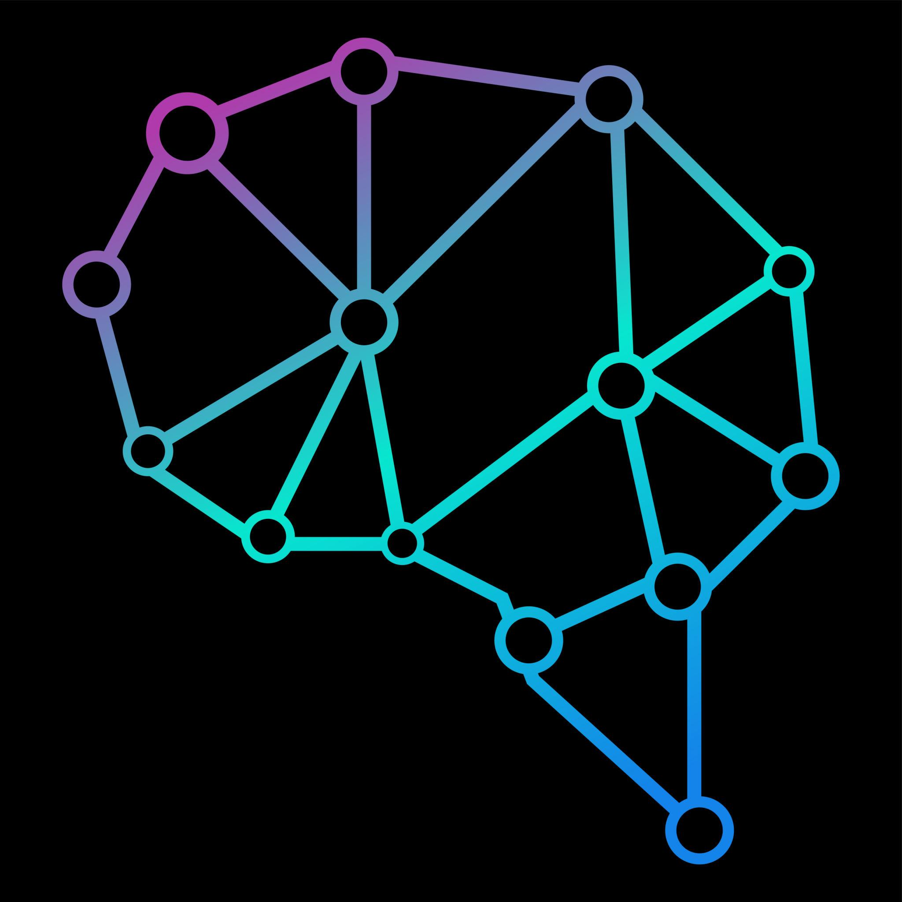
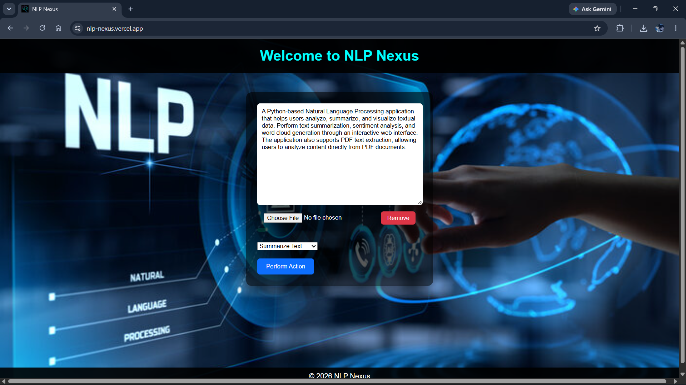
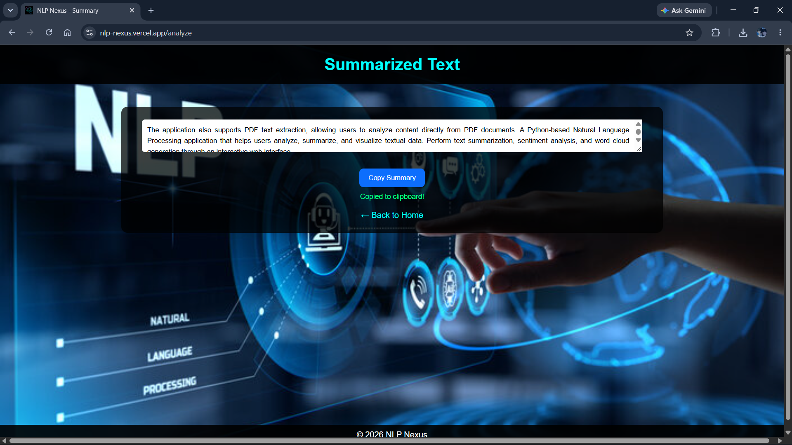
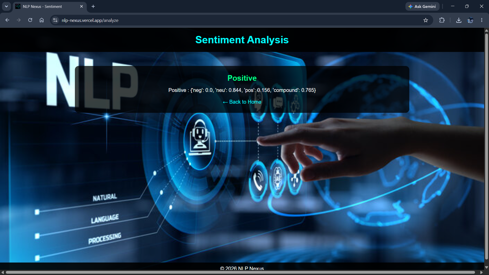
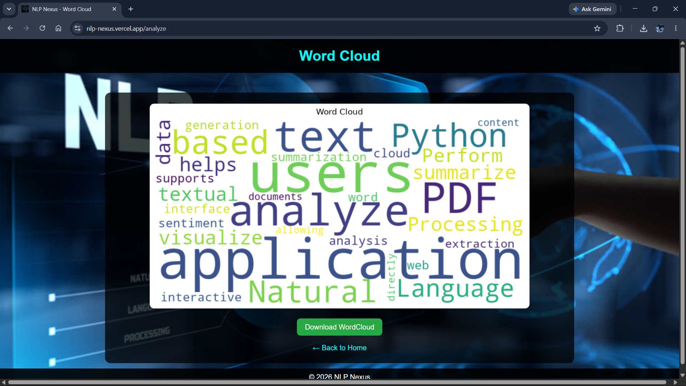

# NLP Nexus


<p align="center">
  
</p>

A Python-based Natural Language Processing application that helps users analyze, summarize, and visualize textual data. Perform text summarization, sentiment analysis, and word cloud generation through an interactive web interface. The application also supports PDF text extraction, allowing users to analyze content directly from PDF documents.

**Live Demo:** [Try NLP Nexus](https://nlp-nexus.vercel.app/)

---

## Overview

NLP Nexus is a web-based text analysis application designed to simplify common Natural Language Processing tasks.

The application provides multiple text analysis capabilities, including extractive text summarization, sentiment classification, and word cloud generation. Users can enter text directly or upload PDF documents to extract content for further analysis.

Built using Python and Flask, the project combines NLP libraries with a simple web interface to make text analysis accessible and convenient.

## Features

- **Text Input:** Enter text directly through the application interface.
- **PDF Text Extraction:** Extract readable text from uploaded PDF documents using PyPDF2.
- **Text Summarization:** Generate concise summaries by identifying important sentences from the input text.
- **Sentiment Analysis:** Analyze textual content and classify sentiment as Positive, Negative, or Neutral using TextBlob and VADER.
- **Word Cloud Generation:** Generate visual representations of frequently occurring words in the submitted text.
- **Result Navigation:** Navigate between the homepage and individual analysis result pages.
- **Copy and Download:** Copy or download supported analysis results.
- **Input Persistence:** Preserve submitted text and uploaded PDF selections during navigation within the browser session.
- **Responsive Interface:** Access the application's features through a web-based interface built with Flask, HTML, CSS, and JavaScript.

## NLP Operations

| Operation             | Description                                                     |
| --------------------- | --------------------------------------------------------------- |
| Text Summarization    | Extracts important sentences to generate concise summaries.     |
| Sentiment Analysis    | Classifies text into Positive, Negative, or Neutral categories. |
| Word Cloud Generation | Visualizes frequently occurring words in the submitted text.    |
| PDF Text Extraction   | Extracts readable text from uploaded PDF documents.             |

*Note: Scanned image-only PDFs are not currently supported because OCR functionality has not been implemented.*

## Application Screenshots

The following screenshots showcase the main features and interface of NLP Nexus.

| Homepage                                         | Text Summarization                                |
| ------------------------------------------------ | ------------------------------------------------- |
|  |   |
| **Sentiment Analysis**                     |  **Word Cloud Generation**                 |
|  |   |

## Tech Stack

- **Language:** Python 3.12
- **Web Framework:** Flask
- **Natural Language Processing:** NLTK, TextBlob
- **Sentiment Analysis:** VADER
- **Numerical Processing:** NumPy
- **PDF Processing:** PyPDF2
- **Visualization:** Matplotlib, WordCloud
- **Frontend:** HTML5, CSS3, JavaScript
- **Deployment:** Vercel

## Project Structure

```text
nlp-nexus/
│
├── public/
│   ├── css/
│   │   └── style.css
│   │
│   └── images/
│       ├── bg.jpg
│       ├── icons.jpg
│       └── nlp-logo.png
│
├── docs/
│   └── screenshots/
│       ├── homepage.png
│       ├── summarization.png
│       ├── sentiment-analysis.png
│       ├── wordcloud.png
│       └── pdf-extraction.png
│
├── src/
│   ├── __init__.py
│   ├── app.py
│   ├── pdf_extractor.py
│   ├── summarizer.py
│   │
│   ├── nltk_data/
│   │   ├── corpora/
│   │   │   └── stopwords/
│   │   ├── sentiment/
│   │   │   └── vader_lexicon.zip
│   │   └── tokenizers/
│   │       ├── punkt/
│   │       └── punkt_tab/
│   │
│   └── templates/
│       ├── index.html
│       ├── sentiment.html
│       ├── summary.html
│       └── wordcloud.html
│
├── .gitignore
├── .python-version
├── requirements.txt
├── LICENSE
└── README.md
```

| File / Directory         | Description                                                        |
| ------------------------ | ------------------------------------------------------------------ |
| `src/app.py`           | Flask application and route handling.                              |
| `src/summarizer.py`    | Text summarization, sentiment analysis, and word cloud generation. |
| `src/pdf_extractor.py` | Extracts text from uploaded PDF documents.                         |
| `src/templates/`       | HTML templates for the application interface and analysis results. |
| `public/`              | CSS stylesheets and application images.                            |
| `docs/screenshots/`    | Application screenshots used in the README.                        |
| `src/nltk_data/`       | Locally bundled NLTK language-processing resources.                |
| `requirements.txt`     | Project dependencies.                                              |
| `.python-version`      | Specifies the Python runtime version.                              |
| `LICENSE`              | MIT License.                                                       |

## Installation

### 1. Clone the Repository

```bash
git clone https://github.com/silverbullet-ai/intelligent-systems.git
```

### 2. Navigate to the Project Directory

```bash
cd intelligent-systems/ml/nlp-nexus
```

### 3. Create a Virtual Environment

**Using Conda:**

```bash
conda create -n nlp-nexus python=3.12 -y
conda activate nlp-nexus
```

**Alternatively, using Python venv:**

```bash
python -m venv .venv
```

Activate the environment:

**Windows:**

```bash
.venv\Scripts\activate
```

**Linux / macOS:**

```bash
source .venv/bin/activate
```

### 4. Install Dependencies

```bash
python -m pip install --upgrade pip
python -m pip install -r requirements.txt
```

### 5. Run the Application

```bash
python -m src.app
```

Open the application in your browser:

```text
http://127.0.0.1:5000/
```

## Application Workflow

1. Open NLP Nexus in your browser.
2. Enter text or upload a PDF document.
3. Select the desired NLP operation.
4. Perform text summarization, sentiment analysis, or word cloud generation.
5. Review the generated results.
6. Copy or download supported results.
7. Return to the homepage to perform another analysis.

## NLTK Resource Management

NLP Nexus uses locally bundled NLTK datasets to provide the language-processing resources required by the application.

The following resources are included:

- `punkt` – Sentence and word tokenization.
- `punkt_tab` – Additional tokenizer data.
- `stopwords` – Common stopwords for text processing.
- `vader_lexicon` – Lexicon used for VADER sentiment analysis.

These resources are stored inside `src/nltk_data/`, and the application is configured to load them locally instead of downloading them at runtime.

## Deployment

NLP Nexus is deployed on **Vercel**.

The deployment uses:

- Python 3.12 runtime.
- Flask application framework.
- Dependencies managed through `requirements.txt`.
- Static assets served from the root-level `public/` directory.
- Locally bundled NLTK resources.

**Production URL:** [https://nlp-nexus.vercel.app/](https://nlp-nexus.vercel.app/)

## Future Improvements

- OCR support for scanned PDF documents.
- Support for additional document formats.
- Improvements to summarization algorithms.
- Advanced sentiment analysis capabilities.
- Additional text visualization techniques.
- Further UI/UX and performance improvements.

## Project Status

**Version:** v1.2.0

**Status:** Deployed and operational.

The application has been deployed to Vercel and its primary features have been tested successfully in the production environment.

## Author

**Aahish Aayan**

AI & Machine Learning Graduate | Aspiring AI Engineer

GitHub: [Silver Bullet](https://github.com/silverbullet-ai)

## License

This project is licensed under the **MIT License**. See the [LICENSE](LICENSE) file for details.
