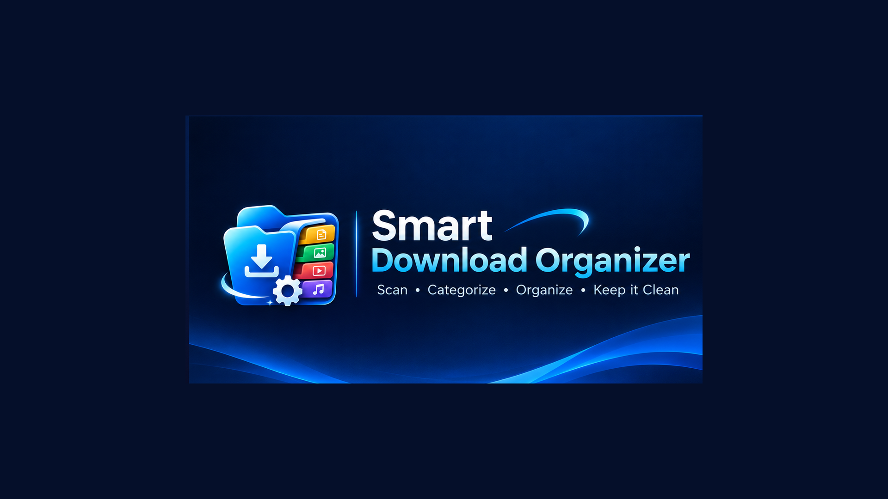

# Smart Download Organizer — Website

<p align="center">
  <strong>The official landing page for Smart Download Organizer.</strong>
</p>

<p align="center">
  
</p>

<p align="center">
  
  
  
  
</p>

---

## Overview

This repository contains the official landing website for **Smart Download Organizer**, a Python-based Windows desktop application designed to simplify file organization through automatic categorization and safe file management.

The website provides users with information about the application, its features, available distributions, and direct access to the latest downloads.

Built using Streamlit, the website features a dark navy and blue interface designed to provide a clean and straightforward user experience.

## Live Website

**[Visit Smart Download Organizer](https://smart-download-organizer.streamlit.app/)**

## Downloads

The website provides access to the latest published application release.

| Distribution      | Description                                                             |
| ----------------- | ----------------------------------------------------------------------- |
| Windows Installer | Guided installation with Start Menu and optional desktop shortcuts.     |
| Portable ZIP      | Extract and run the application without a separate Python installation. |

### Download Links

- [Windows Installer](https://github.com/silverbullet-ai/intelligent-systems/releases/latest/download/SmartDownloadOrganizer-Setup.exe)
- [Portable Version](https://github.com/silverbullet-ai/intelligent-systems/releases/latest/download/SmartDownloadOrganizer-Portable.zip)
- [Latest Release Notes](https://github.com/silverbullet-ai/intelligent-systems/releases/latest)

## Features

### Product Information

- Introduction to Smart Download Organizer.
- Application branding and version information.
- Overview of application capabilities.

### Download Center

- Direct Windows installer download.
- Direct portable ZIP download.
- Links to the latest GitHub release.
- Download options presented through dedicated cards.

### Application Highlights

- File scanning.
- Automatic file categorization.
- Organization preview.
- Safe file movement.
- Undo operations.
- Activity history.
- Configuration management.
- File safety checks.

### Design and User Experience

- Dark navy and blue visual theme.
- Responsive layout.
- Custom styling using CSS.
- Application logo and browser tab icon.
- Consistent download card layouts.

## Tech Stack

| Technology                | Purpose                   |
| ------------------------- | ------------------------- |
| Python                    | Core programming language |
| Streamlit                 | Website framework         |
| Streamlit Community Cloud | Website deployment        |

## Project Structure

```text
smart-download-organizer-website/
│
├── app.py
├── requirements.txt
├── README.md
│
└── assets/
    ├── logo.png
    └── app_icon.png
```

## Installation and Local Setup

Follow these steps to run the website locally.

### 1. Clone the Repository

```bash
git clone https://github.com/silverbullet-ai/intelligent-systems/tree/main/automations/smart-download-organizer-website
```

### 2. Navigate to the Project Directory

```bash
cd smart-download-organizer-website
```

### 3. Create a Virtual Environment

```bash
python -m venv venv
```

### 4. Activate the Virtual Environment

**Windows PowerShell:**

```powershell
.\venv\Scripts\Activate.ps1
```

### 5. Install Dependencies

```powershell
python -m pip install -r requirements.txt
```

### 6. Run the Website

```powershell
streamlit run app.py
```

The website will be available locally at:

```text
http://localhost:8501
```

## Configuration

The website uses centralized configuration variables in `app.py` for:

- Application version.
- GitHub repository URL.
- Project source URL.
- Latest release URL.
- Installer download URL.
- Portable ZIP download URL.
- Application logo and icon paths.

Download links use GitHub's `/releases/latest/download/` endpoint, allowing users to access the latest published release without requiring changes to the download URLs for every new version.

## Deployment

The website is deployed using **Streamlit Community Cloud**.

### Deployment Steps

1. Push the website repository to GitHub.
2. Visit [Streamlit Community Cloud](https://share.streamlit.io/).
3. Connect your GitHub account.
4. Select the `smart-download-organizer-website` repository.
5. Choose the `main` branch.
6. Set `app.py` as the application entry point.
7. Deploy the application.

Streamlit Community Cloud can automatically redeploy the website when new changes are pushed to the connected GitHub repository.

## Related Project

**Smart Download Organizer — Desktop Application**

The main application source code, documentation, tests, and GitHub releases are maintained in the Intelligent Systems repository.

- [Application Source Code](https://github.com/silverbullet-ai/intelligent-systems/tree/main/automations/smart-download-organizer)
- [GitHub Releases](https://github.com/silverbullet-ai/intelligent-systems/releases)
- [Latest Release — v1.0.1](https://github.com/silverbullet-ai/intelligent-systems/releases/tag/v1.0.1)

## Author

**Aahish Aayan (Silver Bullet)** 

- GitHub: [@silverbullet-ai](https://github.com/silverbullet-ai)

---

<p align="center">
  <strong>Built with Python, Streamlit, and a little automation magic.</strong>
</p>
