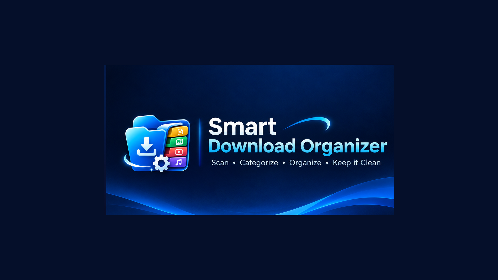
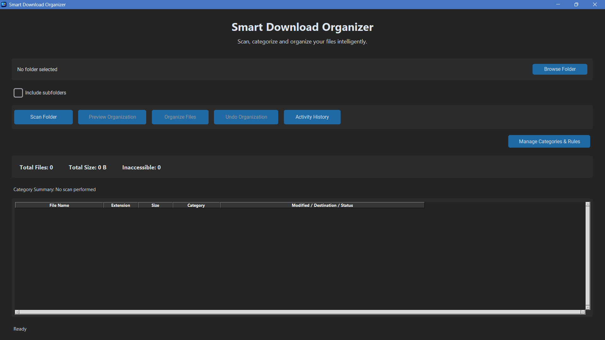
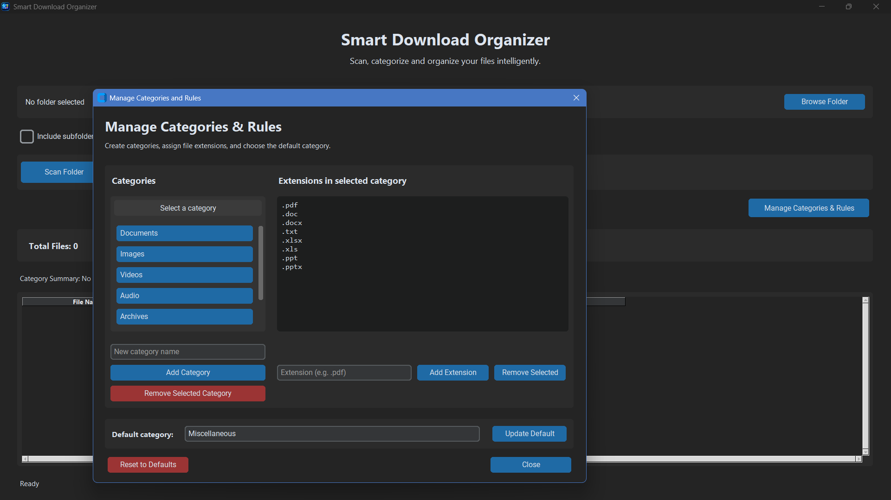
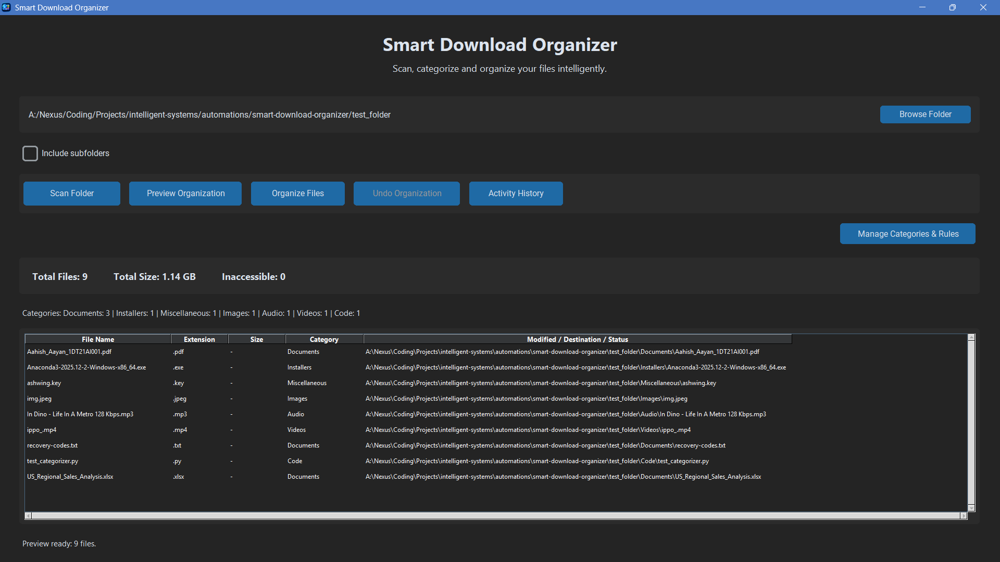
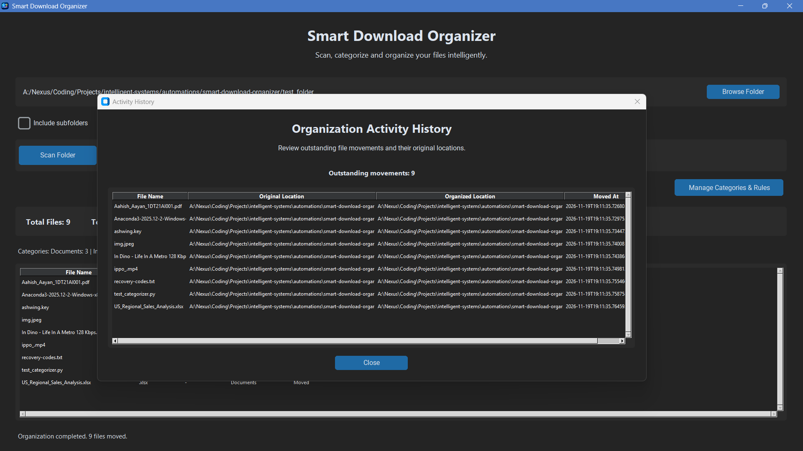

# Smart Download Organizer

<p align="center">
  
</p>

<p align="center">
  **Organize your files. Simplify your digital space.**
</p>

<p align="center">
  
  
  
  
  
</p>

Smart Download Organizer is a Python-based desktop application that automatically organizes files into categorized folders based on their file extensions.

With an intuitive graphical interface, it allows users to scan directories, preview organization plans, customize categorization rules, organize files, review activity history, and undo previous operations.

**Spend less time organizing files and more time getting things done.**

---

## Download

**Smart Download Organizer v1.0.1 is available for Windows.**

<p align="center">
  <a href="https://github.com/silverbullet-ai/intelligent-systems/releases/latest/download/SmartDownloadOrganizer-Setup.exe">
    
  </a>
   
  <a href="https://github.com/silverbullet-ai/intelligent-systems/releases/latest/download/SmartDownloadOrganizer-Portable.zip">
    
  </a>
</p>

| Distribution                 | Description                                                                                      |
| ---------------------------- | ------------------------------------------------------------------------------------------------ |
| Windows Installer (`.exe`) | Guided installation with Start Menu and optional desktop shortcuts, plus uninstallation support. |
| Portable (`.zip`)          | Extract the archive and run the application. No separate Python installation required.           |

**[View all releases](https://github.com/silverbullet-ai/intelligent-systems/releases)**

> **Note:** Windows may display a SmartScreen warning because the application is not code-signed. Download only from the official project repository.

---

## Features

### File Scanning

- Scan selected directories for files.
- Support recursive and non-recursive scanning.
- Collect file metadata, including name, extension, size, and modification time.
- Display scan summaries and file statistics.
- Automatically exclude configured organizer category folders during recursive scans.

### Automatic File Categorization

- Categorize files based on their extensions.
- Support predefined categories.
- Handle unknown extensions using a configurable default category.
- Perform case-insensitive extension matching.
- Manage custom categories and file extensions through the GUI.

### Organization Preview

- Preview the proposed organization plan before moving files.
- Review destination folders and file categories.
- Identify potential changes before executing operations.

### File Organization

- Automatically move files into their respective category folders.
- Prevent accidental overwriting of existing files.
- Generate unique filenames when duplicates exist.
- Detect files that have been modified or deleted after scanning.

### Undo Functionality

- Reverse previously completed organization operations.
- Restore files to their original locations.
- Prevent overwriting files during restoration.
- Retain unsuccessful restoration records for future recovery attempts.

### Activity History

- Maintain persistent movement history.
- Record successful file movements.
- Access previous organization activities.
- Store history separately from the application installation directory.

### Configuration Management

- Add and remove custom categories.
- Add and remove file extensions.
- Change the default category.
- Reset categorization rules to their defaults.
- Store configuration rules in JSON format.
- Preserve user configuration across application restarts.

### Unit Testing

- Automated tests using Python's `unittest` framework.
- Tests covering scanning, categorization, configuration management, and file organization.
- Validation of duplicate handling, undo operations, and file-change detection.

---

## Application Screenshots

<!-- Add actual application screenshots here. -->

| Main Application                                 | Configuration                                     |
| ------------------------------------------------ | ------------------------------------------------- |
|  |   |

| Organization Preview                             | Activity Hist                                    |
| ------------------------------------------------ | ------------------------------------------------ |
|  |  |

---

## Installation

### Option 1: Windows Installer (Recommended)

1. Visit the [Latest GitHub Release](https://github.com/silverbullet-ai/intelligent-systems/releases/latest).
2. Download `SmartDownloadOrganizer-Setup.exe`.
3. Run the installer.
4. Follow the installation wizard.
5. Launch Smart Download Organizer from the Start Menu or desktop shortcut.

No separate Python installation is required.

### Option 2: Portable Version

1. Visit the [Latest GitHub Release](https://github.com/silverbullet-ai/intelligent-systems/releases/latest).
2. Download `SmartDownloadOrganizer-Portable.zip`.
3. Extract the archive into your preferred directory.
4. Open the extracted folder.
5. Run `SmartDownloadOrganizer.exe`.

Keep the extracted application folder intact, including its `_internal` directory.

No separate Python installation is required.

### Option 3: Run from Source

For developers who want to explore or modify the application:

**1. Clone the repository**

```bash
git clone https://github.com/silverbullet-ai/intelligent-systems.git
```

**2. Navigate to the project directory**

```bash
cd intelligent-systems/automations/smart-download-organizer
```

**3. Create a virtual environment**

```bash
python -m venv venv
```

**4. Activate the virtual environment**

Windows PowerShell:

```powershell
.\venv\Scripts\Activate.ps1
```

**5. Install dependencies**

```powershell
python -m pip install -r requirements.txt
```

**6. Run the application**

```powershell
python -m src.main
```

---

## Usage

1. Launch Smart Download Organizer.
2. Select the directory you want to organize.
3. Choose whether to scan subdirectories recursively.
4. Start scanning.
5. Review the detected files and their assigned categories.
6. Preview the proposed organization plan.
7. Execute the organization operation.
8. Access activity history or undo previous operations when needed.

You can also manage categories and file extensions through the configuration interface.

---

## Tech Stack

| Technology    | Purpose                                   |
| ------------- | ----------------------------------------- |
| Python        | Core application logic                    |
| CustomTkinter | Graphical user interface                  |
| JSON          | Configuration and persistent history      |
| pathlib       | File and directory handling               |
| os            | Operating system and directory operations |
| shutil        | File movement                             |
| logging       | Application logging                       |
| unittest      | Automated testing                         |
| PyInstaller   | Standalone application packaging          |
| Inno Setup    | Windows installer creation                |

---

## Project Structure

```text
smart-download-organizer/
│
├── src/
│   ├── __init__.py
│   ├── main.py
│   ├── gui.py
│   ├── scanner.py
│   ├── categorizer.py
│   ├── organizer.py
│   ├── config_manager.py
│   ├── logger.py
│   └── app_paths.py
│
├── config/
│   └── rules.json
│
├── assets/
│   ├── logo.png
│   └── icons/
│       ├── app_icon.ico
│       └── app_icon.png
│
├── logs/
│
├── tests/
│   ├── __init__.py
│   ├── test_scanner.py
│   ├── test_categorizer.py
│   ├── test_organizer.py
│   └── test_config_manager.py
│
├── SmartDownloadOrganizer.spec
├── SmartDownloadOrganizer.iss
├── requirements.txt
├── README.md
├── LICENSE
└── .gitignore
```

---

## Running Tests

The project uses Python's built-in `unittest` framework.

Run the complete test suite from the project root:

```powershell
python -m unittest discover -s tests -v
```

Run individual test modules:

```powershell
python -m unittest tests.test_scanner -v
python -m unittest tests.test_categorizer -v
python -m unittest tests.test_organizer -v
python -m unittest tests.test_config_manager -v
```

### Current Test Results

| Module          |        Tests |
| --------------- | -----------: |
| Scanner         |           11 |
| Categorizer     |           12 |
| Config Manager  |           10 |
| Organizer       |           12 |
| **Total** | **45** |

**Current status: 45/45 tests passing.**

---

## Data Storage

Smart Download Organizer stores its application data separately from the installation directory.

On Windows, the application uses:

```text
%APPDATA%\SmartDownloadOrganizer\
│
├── config/
│   └── rules.json
│
└── logs/
    ├── smart_organizer.log
    └── organization_history.json
```

This separation helps preserve user configuration and activity history independently of the installed application files.

---

## Safety Considerations

Smart Download Organizer includes safeguards to reduce accidental file loss:

- Existing destination files are not overwritten.
- Duplicate filenames receive unique names.
- Files modified after scanning are skipped.
- Deleted files are detected before movement.
- Undo operations check whether original locations are occupied.
- File movement history is maintained for reversal.

**Important:** Although safeguards and undo functionality are implemented, always maintain backups of important files. Undo history is not a substitute for a backup system.

---

## Roadmap

Potential improvements for future versions:

- [ ] Improved dashboard with file statistics and visualizations.
- [ ] Drag-and-drop folder selection.
- [ ] Scheduled automatic organization.
- [ ] Advanced filtering and search.
- [ ] Additional file metadata and categorization rules.
- [ ] Improved error reporting and recovery.
- [ ] Dark and light theme customization.
- [ ] Additional platform support.

---

## Project Status

**Version 1.0.1 — Patch Release**

The core application functionality has been implemented and tested. Windows portable and installer distributions have been prepared.

Future development will focus on usability, reliability, additional automation capabilities, and improved data visualization.

---

## Author

**Aahish Aayan (Silver Bullet)** 

GitHub: [@silverbullet-ai](https://github.com/silverbullet-ai)  

Project: [Smart Download Organizer](https://github.com/silverbullet-ai/intelligent-systems/tree/main/automations/smart-download-organizer)  

Repository: [Intelligent Systems](https://github.com/silverbullet-ai/intelligent-systems)

---

<p align="center">
  **Built with Python, curiosity, and a little automation magic.**
</p>
